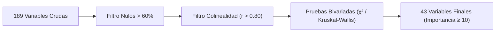
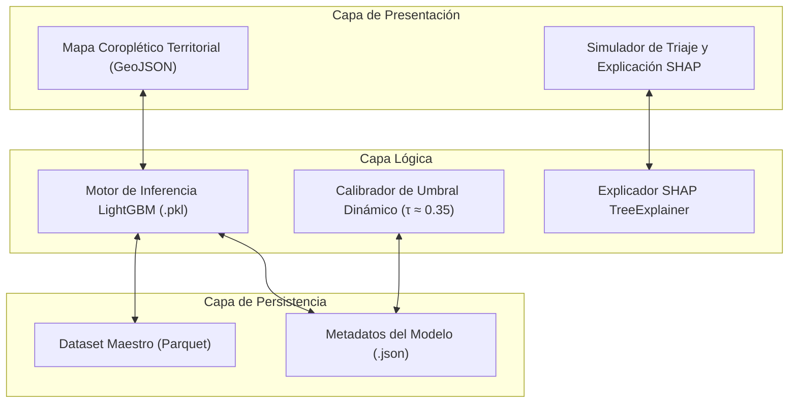

# SECCIÓN: METODOLOGÍA (Formato Artículo Científico)

## III. METODOLOGÍA

La presente investigación se desarrolló bajo el marco estándar CRISP-DM (*Cross-Industry Standard Process for Data Mining*), articulando el ciclo de vida analítico en fases secuenciales que abarcan la ingesta relacional de datos, el preprocesamiento con control de fuga de información, la selección de características, el entrenamiento y evaluación comparativa de algoritmos supervisados, la interpretabilidad algorítmica y el despliegue del sistema de soporte a la decisión.

### A. Fuente de Datos e Integración Relacional

El estudio utilizó los microdatos anuales de la Encuesta Demográfica y de Salud Familiar (ENDES), recolectados y publicados por el Instituto Nacional de Estadística e Informática (INEI) de Perú entre los años 2007 y 2024. Para estructurar la unidad de análisis, se diseñó un flujo de extracción e integración relacional que vinculó cinco módulos principales mediante las llaves compuestas `HHID` y `CASEID`. El módulo `RECH0` proveyó los metadatos de la entrevista, `RECH1` aportó las características demográficas de los integrantes del hogar, `RECH6` suministró los indicadores antropométricos y de salud infantil, `RECH23` consolidó las condiciones de vivienda, saneamiento y altitud geográfica, y el módulo `REC41` incorporó la historia obstétrica materna, controles prenatales y peso al nacer, vinculado de forma unívoca a través de la tabla relacional puente `REC21`. La muestra consolidada quedó conformada por 285,284 niños y niñas menores de cinco años que contaban con registros antropométricos válidos y superaron la auditoría biológica de consistencia entre el registro infantil y materno con una coincidencia superior al 99.9% en sexo y año de nacimiento.

### B. Definición de la Variable Objetivo y Protocolo Anti-Leakage

La variable dependiente es la desnutrición crónica infantil, categorizada de acuerdo con los estándares internacionales de crecimiento de la Organización Mundial de la Salud (OMS). Se definió como caso positivo ($Y = 1$) a todo infante cuyo puntaje Z de talla para la edad ($\text{HAZ} = \text{HC70} / 100$) se situó por debajo de menos dos desviaciones estándar respecto a la mediana de referencia, y como caso control ($Y = 0$) en caso contrario. La prevalencia global en la serie histórica fue del 16.1%, estableciendo un ratio de desbalance de 1 a 5.2. Para preservar la validez metodológica y evitar el sobreajuste espurio por fuga de datos (*data leakage*), se excluyeron de las variables predictoras la talla directa en centímetros (`HC3`) y el peso crudo (`HC2`), así como cualquier intervención terapéutica o diagnóstico clínico registrado con posterioridad a la medición antropométrica.

$$Y = \begin{cases} 1, & \text{si } \text{HAZ} < -2.00\text{ DE} \\ 0, & \text{si } \text{HAZ} \ge -2.00\text{ DE} \end{cases}$$

### C. Pipeline de Selección de Características

El espacio original compuesto por 189 columnas crudas fue depurado a través de un protocolo de selección cuantitativo en cuatro etapas sucesivas. En la primera etapa, se descartaron los atributos con más del 60% de valores ausentes estructurales históricos. En la segunda etapa, se redujo la redundancia dimensional eliminando variables colineales mediante correlación bivariada de Pearson y Spearman ($r > 0.80$) y factores de inflación de varianza ($\text{VIF} > 5$). En la tercera etapa, se aplicaron pruebas de hipótesis bivariadas compuestas por pruebas de Independencia de Chi-cuadrado para variables categóricas y pruebas no paramétricas de Kruskal-Wallis para continuas, reteniendo 74 factores estadísticamente significativos con un nivel de significancia $p < 0.05$. Finalmente, en la cuarta etapa se ejecutó una validación multivariada basada en la importancia algorítmica nativa de árboles de decisión gradiente, seleccionando un conjunto final de 43 variables que conservaron la totalidad del poder discriminativo del modelo.

### D. Entrenamiento, Balanceo y Benchmarking de Modelos

El proceso de entrenamiento evaluó seis familias de algoritmos supervisados: Regresión Logística con regularización L2, Árbol de Decisión CART, XGBoost, CatBoost, Red Neuronal Perceptrón Multicapa (MLP 3×200) y LightGBM. Para reflejar la distribución demográfica del país y corregir el sesgo de sobremuestreo urbano inherente a la encuesta, se incorporó el factor de ponderación muestral del INEI ($w_i = \text{HV005}_i / 1,000,000$). La partición y validación experimental se realizaron mediante validación cruzada estratificada de 5 pliegues (*Stratified 5-Fold Cross-Validation*) fijando una semilla determinista (`random_state = 42`). El algoritmo LightGBM obtuvo el desempeño más alto con un área bajo la curva ROC de 0.8308 y una sensibilidad (*Recall*) de 76.49% a umbral estándar, superando a los modelos restantes gracias a su capacidad nativa para agrupar variables categóricas de alta cardinalidad por histogramas sin recurrir a la expansión dimensional del *One-Hot Encoding*.

### E. Explicabilidad Algorítmica con Valores SHAP

Para dotar de transparencia al sistema y eliminar el carácter opaco del modelo de ensamble, se aplicó la teoría de juegos cooperativos mediante el algoritmo `TreeExplainer` del framework SHAP (*SHapley Additive exPlanations*). Este marco descompone la probabilidad predicha en la suma del valor base poblacional más las contribuciones marginales individuales de cada una de las 43 variables predictoras. A nivel local, el sistema descompone la predicción individual en factores de riesgo agravantes y condiciones protectoras. A nivel global y territorial, se agregaron los valores SHAP sobre una muestra representativa de 10,000 registros para construir mapas de riesgo y perfiles de determinantes diferenciados para los 25 departamentos y las tres regiones naturales del país.

$$f(x) = \phi_0 + \sum_{j=1}^{M} \phi_j(x)$$

### F. Protocolo de Validación Metodológica

La validación del sistema se estructuró en tres ejes que abarcan la solidez estadística, la replicabilidad computacional y la pertinencia técnica del software. El primer eje certificó la confiabilidad mediante remuestreo *Bootstrap* no paramétrico con 1,000 repeticiones para estimar los intervalos de confianza al 95% del AUC-ROC ($[0.820, 0.840]$) y del *Recall* ($[75.0\%, 78.5\%]$), la prueba de significancia estadística de DeLong ($p < 0.001$) respecto a los modelos de referencia, y la calibración del umbral de decisión a $\tau \approx 0.35$ para alcanzar una cobertura del 80.0% orientada al triaje preventivo. El segundo eje garantizó la replicabilidad según los principios FAIR mediante la modularización del código en el paquete Python `mnp/`, el aislamiento del entorno con Docker (`python:3.12-slim`), la automatización del flujo completo mediante `Makefile` y la publicación del dataset maestro y modelo serializado en el repositorio abierto Zenodo con identificador digital DOI. El tercer eje evaluó la pertinencia técnica mediante un panel de juicio de tres expertos en Ciencia de Datos y Machine Learning, verificando la validez de contenido con el coeficiente V de Aiken ($V \ge 0.80$) y la usabilidad técnica de la herramienta mediante la escala estandarizada SUS con una meta de calificación superior a 75 puntos.

### G. Arquitectura de Software y Despliegue

La solución computacional se implementó como una aplicación web interactiva desarrollada en Streamlit, organizada bajo un patrón de tres capas. La capa de presentación contiene el módulo de visualización coroplética departamental con geometrías GeoJSON y el simulador de triaje individual con gráficos interactivos. La capa lógica integra el motor de inferencia entrenado con LightGBM, el calibrador dinámico de punto de corte y el generador de explicabilidad SHAP en tiempo de ejecución. La capa de datos gestiona el almacenamiento columnar de alto rendimiento en formato Parquet junto con los metadatos de configuración serializados en formato JSON.

