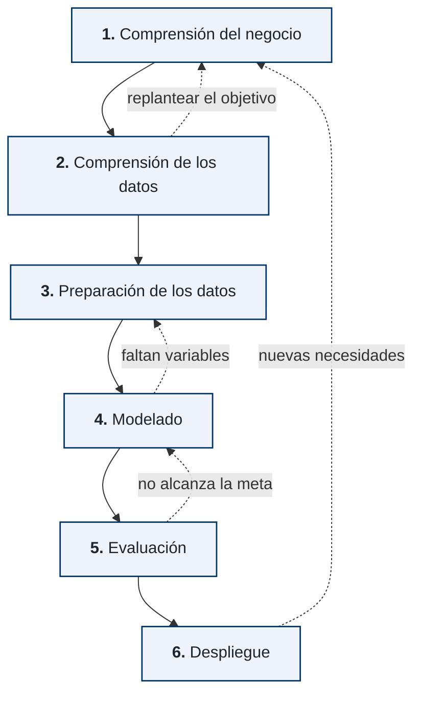

# SOLICITUD DE VALIDACIÓN POR JUICIO DE EXPERTOS

**Proyecto:** *Modelo Predictivo de Riesgo de Desnutrición Crónica Infantil en el Perú mediante Machine Learning*

**Institución:** Universidad Peruana Unión (UPeU) — Facultad de Ingeniería y Arquitectura, EP Ingeniería de Sistemas
**Asignatura:** Investigación V (Ciclo X – 2026-II) · **Docente:** Mg. Nemias Saboya Rios
**Equipo:** Abel Guevara Huasco (abelguevara@upeu.edu.pe) · Verónica Vergara Rojas
(veronica.vergara@upeu.edu.pe) · Pamela Vallejos Cotrina (zulin.vallejos@upeu.edu.pe)

---

## 1. Objetivo

Predecir el **perfil de riesgo de desnutrición crónica infantil** en menores de 5 años a partir de
variables sociodemográficas, del hogar y de salud materna recogidas por encuesta, con el fin de
**orientar la focalización de recursos** en salud pública.

El sistema **no reemplaza el diagnóstico clínico ni la medición antropométrica**. Funciona como una
herramienta de **triaje**: dado el perfil de un hogar, estima la probabilidad de que el niño presente
desnutrición crónica, permitiendo priorizar a quién atender primero cuando el presupuesto no alcanza
para cubrir a toda la población.

**Qué datos necesita y cuáles no.** El modelo **no utiliza el peso ni la talla actuales del niño**: esas
dos mediciones definen el diagnóstico, de modo que incluirlas convertiría la predicción en una
tautología. Sí emplea el **peso y el tamaño al nacer**, que son antecedentes recogidos por entrevista o
disponibles en el carné de control.

La única variable que exige un procedimiento de laboratorio es la **hemoglobina ajustada por altitud**,
habitualmente disponible en el tamizaje de anemia de los controles CRED. El resto son respuestas de
encuesta sobre el hogar, la vivienda y la historia materna. En consecuencia, el sistema opera sobre
información que en su mayor parte puede obtenerse sin medir al niño, pero no es un instrumento
enteramente ajeno al registro clínico previo.

**Pregunta de investigación:** ¿Puede un modelo de *Machine Learning* identificar, a partir del perfil
sociodemográfico del hogar y la historia materna, qué niños tienen mayor riesgo de desnutrición crónica
sin recurrir a la medición antropométrica que define el diagnóstico?

---

## 2. Método

Se siguió **CRISP-DM** (*Cross-Industry Standard Process for Data Mining*), estándar de la industria
para proyectos de ciencia de datos, organizado en seis fases:

Las flechas continuas marcan el avance y las punteadas los **retornos**: el proceso no es lineal, y
cada fase puede obligar a rehacer una anterior. Los dos retornos que más pesaron en este proyecto
fueron el de modelado a preparación —al detectar variables que exigían otra codificación— y el de
evaluación a modelado, al calibrar el umbral de decisión para alcanzar la sensibilidad requerida.

| Aspecto | Definición |
|---|---|
| Fuente | ENDES — INEI (Encuesta Demográfica y de Salud Familiar), datos públicos |
| Periodo | 2007 – 2025 (19 años) |
| Muestra | **304,271 niños** menores de 5 años con antropometría válida |
| Variable objetivo | Desnutrición crónica: Z-score Talla/Edad (`HC70`) < −2 DE, estándar OMS / KPI 4 del INEI |
| Prevalencia | 15.8% |
| Tipo de problema | Clasificación binaria supervisada |
| Validación | Validación cruzada estratificada 5-*fold* con ponderación muestral del INEI (`HV005`) |

**Decisión metodológica central:** se **excluyeron deliberadamente el peso y la talla directos del
niño** (`HC2`, `HC3`) y los Z-scores derivados, siguiendo el criterio de prevención de fuga de
información (Kaufman et al., 2011). Si el modelo conociera la talla, el diagnóstico sería
trivial y no habría predicción. El modelo aprende únicamente de variables *no obvias* —condiciones del
hogar, historia materna y entorno— que la encuesta puede recoger sin medir al niño.

### Resultados actuales

Entre seis algoritmos evaluados resultó campeón **LightGBM**. La tabla traduce cada métrica a lo que
significa en la práctica:

| Métrica | Valor (IC 95%) | Qué significa en la práctica |
|---|---|---|
| Capacidad de discriminación (AUC-ROC) | **0.829** (0.827 – 0.832) | Tomados al azar un niño con desnutrición crónica y otro sin ella, el sistema asigna mayor riesgo al primero en **83 de cada 100 casos** |
| Sensibilidad o cobertura | **76.4%** (75.9% – 77.0%) | De cada 100 niños que sí tienen desnutrición crónica, el sistema señala a **76** |
| Casos no detectados | 23.6% | **24 de cada 100** niños afectados pasarían inadvertidos con el umbral actual |
| Precisión de la alerta | 36.4% | De cada 100 niños señalados como riesgo, **36 lo confirman**; los demás requieren verificación |

**Sobre el margen de error.** Los intervalos de confianza se estimaron con *bootstrap* de 1,000
remuestreos. Su amplitud es inferior a medio punto porcentual, lo que indica que las cifras no dependen
de qué subconjunto de niños se use para evaluar: el desempeño es estable.

**Sobre el equilibrio entre cobertura y precisión.** El punto de corte es ajustable y los dos valores se
mueven en direcciones opuestas. Elevando la cobertura al 80% el sistema detecta más casos reales, pero
también emite más alertas que luego no se confirman. La decisión se tomó deliberadamente a favor de la
cobertura: en un esquema de priorización, dejar sin detectar a un niño con desnutrición es más costoso
que una visita de verificación innecesaria.

---

## 3. Variables que intervienen (45)

Esta tabla define **cómo debe venir codificada cada variable** en un conjunto de datos externo. El
modelo compara valores de forma literal: una categoría escrita de otra manera (`"URBANO"` en lugar de
`"Urbano"`, o `1`/`0` en lugar de `"Si"`/`"No"`) no produce un error visible, sino una predicción
degradada en silencio. Por eso el formato importa tanto como la variable misma.

**Convenciones**

- *Categórica nominal*: texto, exactamente uno de los valores listados. No hay orden entre ellos.
- *Categórica ordinal*: texto, con orden implícito (de mayor a menor, según se lista).
- *Binaria*: texto, `Sí` o `No`.
- *Numérica*: magnitud real, en la unidad indicada. Aquí el número **sí** representa una cantidad.
- Un campo ausente debe dejarse **vacío**, nunca rellenarse con 0, 999 o "NA": el modelo maneja
  valores faltantes de forma nativa y cada variable tolera el porcentaje de vacíos que se indica.

Las categorías se entregan **en texto, no en código numérico**. El `1` de una variable nominal no es
una cantidad sino una etiqueta arbitraria, y su significado cambia entre ediciones de la encuesta: es
preferible escribir `Electricidad` antes que `1`. Si el sistema de origen almacena códigos, basta con
adjuntar su diccionario de valores.

### Niño
| Código | Tipo | Valores admitidos | Unidad | % nulos tolerado |
|---|---|---|---|---:|
| `HC1` | Numérica | 0 – 59 | meses | 0.0 |
| `HC27` | Categórica nominal | `Hombre` / `Mujer` | sexo del niño | 0.0 |
| `HC56` | Numérica | 4 – 20 (hemoglobina ajustada) | g/dL | 9.6 |
| `HC63` | Numérica | 7 – 388 | meses desde el parto anterior | 36.3 |
### Salud materna, embarazo y lactancia
| Código | Tipo | Valores admitidos | Unidad | % nulos tolerado |
|---|---|---|---|---:|
| `M13` | Numérica | 0 – 9 | mes de gestación del 1.er control | 19.7 |
| `M14` | Numérica | 0 – 20 | número de visitas | 18.6 |
| `m15` | Categórica nominal | `Institucional` / `Domiciliario` | lugar del parto | 6.6 |
| `M17` | Binaria | `Sí` / `No` | ¿el parto fue por cesárea? | 5.8 |
| `M18` | Categórica ordinal | `Muy grande` / `Grande` / `Mediano (normal)` / `Pequeño` / `Muy pequeño` | tamaño percibido al nacer | 5.8 |
| `m19` | Numérica | 0.5 – 6.0 | kilogramos (decimal) | 10.6 |
| `M4` | Numérica | 0 – 59 | meses de lactancia | 5.8 |
| `m34` | Numérica | 0 – 2352 | horas hasta iniciar lactancia | 6.2 |
| `M46` | Numérica | 0 – 364 | días que tomó hierro | 18.7 |
| `M54` | Binaria | `Sí` / `No` | vitamina A en los 2 meses post parto | 19.7 |
| `M55G` | Binaria | `Sí` / `No` | fórmula en los 3 primeros días | 6.8 |
| `M60` | Binaria | `Sí` / `No` | antiparasitarios durante el embarazo | 19.9 |
| `HC62` | Numérica | 0 – 9 | años de educación aprobados por la madre | 4.8 |
### Hogar y nivel socioeconómico
| Código | Tipo | Valores admitidos | Unidad | % nulos tolerado |
|---|---|---|---|---:|
| `HV271` | Numérica | −2.2 a 2.2 (aprox.) | índice de riqueza del hogar, en desviaciones respecto a la media nacional | 0.8 |
| `HV012` | Numérica | 0 – 25 | personas | 0.0 |
| `HV014` | Numérica | 0 – 10 | niños menores de 5 años en el hogar | 0.0 |
| `HV219` | Categórica nominal | `Masculino` / `Femenino` | sexo del jefe del hogar | 0.0 |
| `HV220` | Numérica | 12 – 97 | años | 0.0 |
| `HV102` | Binaria | `Sí` / `No` | residente habitual del hogar | 2.4 |
| `HV025` | Categórica nominal | `Urbano` / `Rural` | área de residencia | 0.0 |
### Agua, saneamiento e higiene (WASH)
| Código | Tipo | Valores admitidos | Unidad | % nulos tolerado |
|---|---|---|---|---:|
| `HV204` | Numérica | 0 – 600 | minutos hasta la fuente | 0.1 |
| `HV225` | Binaria | `Sí` / `No` | ¿comparte servicio higiénico? | 10.8 |
| `HV234` | Numérica | 0, 7, 15, 30 | yodo en sal (ppm por colorimetría) | 4.8 |
| `HV237` | Binaria | `Sí` / `No` | ¿trata el agua? | 0.0 |
| `HV237A` | Binaria | `Sí` / `No` | ¿hierve el agua? | 0.0 |
| `HV237G` | Binaria | `Sí` / `No` | ¿consume agua embotellada? | 8.1 |
| `SH42` | Binaria | `Sí` / `No` | ¿dispone de agua todo el día? | 20.4 |
| `SH48` | Binaria | `Sí` / `No` | ¿conserva agua? | 15.8 |
| `SH49` | Categórica nominal | `Olla, tetera` / `Balde` / `Jarra` / `Bidón` / `Otro` | recipiente donde conserva el agua | 20.4 |
| `SH50` | Binaria | `Sí` / `No` | ¿usa el recipiente con tapa? | 19.3 |
### Vivienda y entorno
| Código | Tipo | Valores admitidos | Unidad | % nulos tolerado |
|---|---|---|---|---:|
| `HV040` | Numérica | 0 – 5053 | metros sobre el nivel del mar | 0.0 |
| `HV216` | Numérica | 0 – 14 | habitaciones para dormir | 0.0 |
| `HV240` | Categórica nominal | `Ni chimenea ni campana` / `Tubo de lámpara` / `Capucha` | extracción de humo en la cocina | 55.9 |
| `HV242` | Binaria | `Sí` / `No` | ¿cuarto separado para cocinar? | 9.3 |
| `SH63` | Binaria | `Sí` / `No` | ¿usa otro combustible para cocinar? | 2.1 |
| `SH70` | Categórica nominal | `Electricidad` / `GLP` / `Gas natural` / `Kerosene` / `Velas` / `Batería` / `Otro` | tipo de alumbrado | 1.6 |
| `SH71` | Numérica | 1 – 30 | habitaciones del hogar | 0.0 |
| `SH76B` | Binaria | `Sí` / `No` | ventanas con cristal | 16.2 |
| `SH76C` | Binaria | `Sí` / `No` | ventanas de madera | 16.2 |
| `SH76D` | Binaria | `Sí` / `No` | ventanas con malla | 16.2 |
| `SH77F` | Binaria | `Sí` / `No` | otro tipo de transporte | 0.0 |
## 4. Variables adicionales deseables

Las 45 variables anteriores son las que el modelo **usa hoy** y constituyen el mínimo necesario para
contrastarlo. Las que siguen **no están en el modelo actual** y se solicitan porque la literatura
epidemiológica las identifica como determinantes de la desnutrición crónica que la ENDES no permite
cubrir con suficiente completitud.

Su inclusión es **opcional**: el sistema funciona sin ellas. Pero cada dimensión que el conjunto de
datos externo pueda aportar abre la posibilidad de una versión mejorada del modelo, y su ausencia es
hoy una limitación declarada del estudio.

El marco de referencia es el **modelo conceptual de UNICEF** sobre desnutrición infantil, que ordena
las causas en tres niveles y que la serie de nutrición materno-infantil de *The Lancet* sistematiza
(Black et al., 2013; Victora et al., 2021). El modelo actual cubre bien los niveles básico y subyacente —pobreza,
educación, agua y saneamiento, vivienda— pero tiene un vacío en el **nivel inmediato**, que es
precisamente donde actúa la intervención nutricional.

### Prioridad alta — nivel inmediato (el vacío principal)

| Dimensión | Campo sugerido | Por qué importa |
|---|---|---|
| Morbilidad reciente | Episodios de diarrea en las últimas 2 semanas (sí/no) | Vía infecciosa hacia la malabsorción de nutrientes |
| Morbilidad reciente | Infección respiratoria aguda en las últimas 2 semanas (sí/no) | Impacto directo sobre el estado nutricional |
| Ingesta | Diversidad dietética mínima (número de grupos de alimentos en 24 h) | Indicador OMS de calidad de la alimentación |
| Ingesta | Frecuencia mínima de comidas según edad | Complemento del anterior |
| Suplementación | Recibe micronutrientes o hierro (sí/no, frecuencia) | Intervención directa y modificable |

### Prioridad media — estado nutricional materno y servicios

| Dimensión | Campo sugerido | Por qué importa |
|---|---|---|
| Antropometría materna | Talla de la madre (cm) | Predictor consistente de retraso del crecimiento intergeneracional; resultó la variable más influyente en un modelo equivalente sobre datos DHS (Ndagijimana et al., 2025) |
| Antropometría materna | Peso / IMC de la madre | Estado nutricional del hogar |
| Servicios de salud | Controles CRED al día (sí/no, número) | Seguimiento del crecimiento en el sistema peruano |
| Servicios de salud | Esquema de vacunación completo para la edad (sí/no) | *Proxy* de acceso efectivo a servicios |

### Prioridad media — contexto social

| Dimensión | Campo sugerido | Por qué importa |
|---|---|---|
| Etnicidad | Lengua materna de la madre | Marcador de exclusión estructural especialmente relevante en el Perú |
| Seguridad alimentaria | Escala de inseguridad alimentaria del hogar (ELCSA o similar) | Acceso efectivo a alimentos, no solo capacidad económica |
| Cuidado | Situación laboral de la madre / cuidador principal | Tiempo disponible para prácticas de cuidado |
| Programas sociales | Beneficiario de Juntos, Cuna Más, Qali Warma (sí/no) | Permite evaluar cobertura frente a necesidad |

---

## 5. Qué esperamos de esta validación

Solicitamos la participación de **cinco especialistas** en nutrición, salud pública, epidemiología o
enfermería, idealmente con representación territorial (**2 de costa, 2 de sierra, 1 de selva**), para
dos procesos complementarios:

### 5.1 Pertinencia
Valoración de la **utilidad percibida** del sistema mediante un instrumento estructurado que el
especialista completará tras una demostración del aplicativo. Se evalúa si la herramienta resulta útil,
comprensible y aplicable en la práctica real de focalización sanitaria, y qué limitaciones o variables
faltantes identifica desde su experiencia profesional.

*Modalidad:* sesión virtual, coordinada según disponibilidad. El equipo provee el protocolo, conduce la
demostración y registra la sesión.

### 5.2 Replicabilidad
Contraste del modelo frente a **datos externos** distintos de la ENDES. El procedimiento consiste en que
el especialista aporte registros de su ámbito —incluyendo casos con y sin desnutrición diagnosticada—,
el sistema emita su estimación de riesgo, y se compare con el diagnóstico clínico conocido.

Esto permite medir si el modelo mantiene su desempeño en una realidad distinta de aquella con la que fue
entrenado. Se requieren **datos crudos** (no reportes agregados), con las variables listadas en la
sección 3.

---

## 6. Consideraciones éticas

Los datos con los que se construyó el modelo son de **acceso público y libre** (portal de microdatos del
INEI), por lo que su tratamiento no requirió aprobación de comité de ética.

Para la fase de validación con datos institucionales, el equipo se compromete a tramitar los permisos
formales correspondientes y a someter el protocolo a comité de ética cuando la institución lo exija. Los
datos que se reciban se usarán exclusivamente con fines de validación técnica, de forma anonimizada, y
no serán publicados ni compartidos con terceros.

---

## 7. Contribución esperada para los participantes

Los especialistas que participen serán reconocidos en el artículo científico resultante. Asimismo, el
equipo queda disponible para integrarse como soporte técnico en investigaciones posteriores que deseen
aplicar el modelo en estudios de campo, intervención o gestión sanitaria.

---

*Contacto: Abel Guevara Huasco — abelguevara@upeu.edu.pe*
*EP Ingeniería de Sistemas, Universidad Peruana Unión.*

---

## Referencias citadas

- Black, R. E., Victora, C. G., Walker, S. P., *et al.* (2013). Maternal and child undernutrition and
  overweight in low-income and middle-income countries. *The Lancet*, 382(9890), 427–451.
- Kaufman, S., Rosset, S., & Perlich, C. (2011). Leakage in data mining: formulation, detection, and
  avoidance. *Proceedings of the 17th ACM SIGKDD*, 556–563.
- Ndagijimana, S., Kabano, I., Masabo, E., & Ntaganda, J. M. (2025). Predicting stunting status among
  under-5 children in Rwanda using neural network model. *F1000Research*, 13, 128.
- Victora, C. G., Christian, P., Vidaletti, L. P., *et al.* (2021). Revisiting maternal and child
  undernutrition in low-income and middle-income countries. *The Lancet*, 397(10282), 1388–1399.
